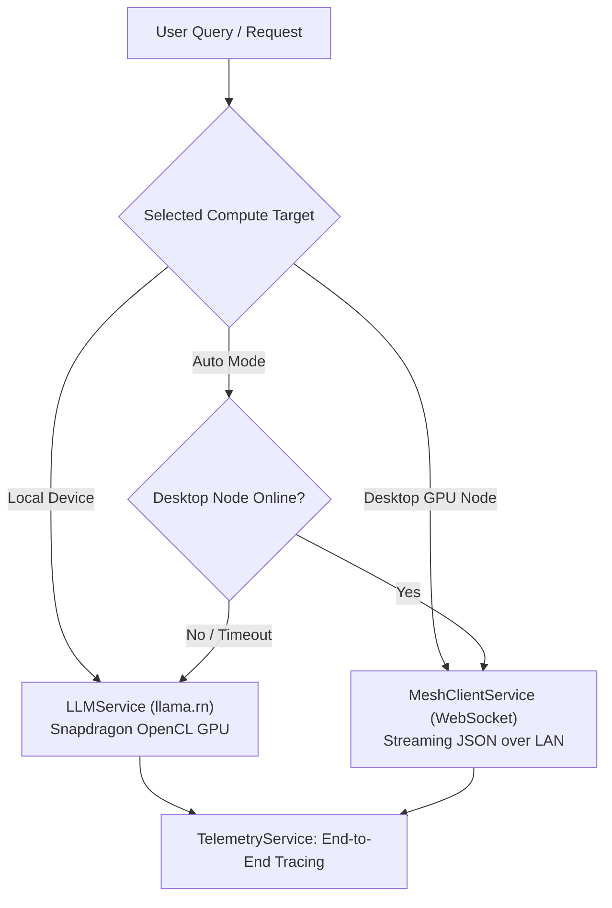
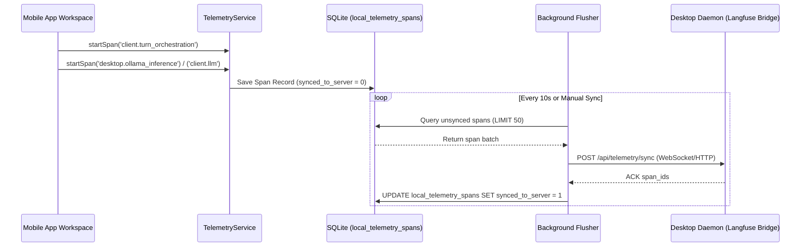
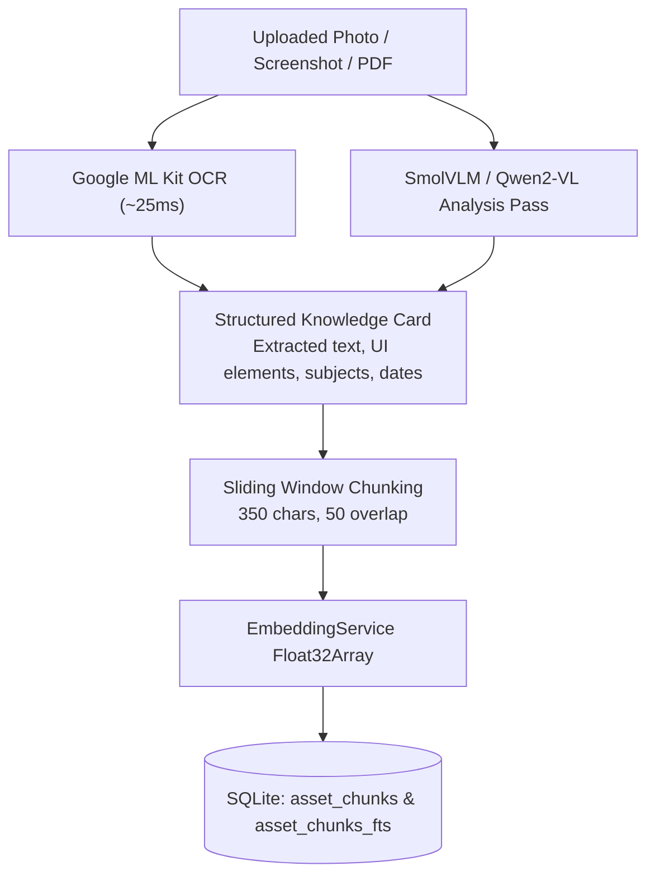

# EdgeAnalyzer Mobile — Architecture & Design Specification 📱⚡

**EdgeAnalyzer Mobile** is an on-device multimodal AI assistant and distributed intelligence runtime for Android. Built with React Native, Expo SDK 54, and native `llama.cpp` bindings (`llama.rn`), it seamlessly executes local inference (using Adreno/OpenCL GPU acceleration) and dynamically offloads complex workloads across a local Wi-Fi mesh to high-performance Desktop GPU nodes.

This document details the system design, database schemas, hybrid RAG pipelines, and distributed telemetry outbox architecture.

---

## 1. System Overview & Technology Stack

| Layer | Technology | Operational Role |
| --- | --- | --- |
| **App Framework** | React Native 0.81.5 / Expo SDK 54 | Native Android application lifecycle, navigation, and UI components |
| **On-Device Inference** | `llama.rn` (v0.13.0-rc.0) / `llama.cpp` | Local GGUF LLM and VLM execution via JNI/C++ bindings |
| **Local Acceleration** | OpenCL / Qualcomm Adreno GPU | On-device hardware acceleration for mobile Snapdragon SoCs |
| **Distributed Mesh** | Custom `MeshClientService` (WebSocket + mDNS) | LAN discovery and streaming offload to Desktop GPU compute nodes |
| **Vision & Preprocessing** | Google ML Kit + `expo-image-manipulator` | ~25ms on-device OCR and 448px visual downscaling |
| **Persistence Engine** | `expo-sqlite` / SQLite 3 (WAL mode) | Local persistence for conversations, notebooks, vector blobs, and telemetry spans |
| **Full-Text & Vector Search** | SQLite FTS5 + Cosine Similarity (Float32Array) | On-device hybrid RAG search |
| **Telemetry & Observability** | Custom `TelemetryService` + SQLite Outbox | Offline-first distributed trace capture and Langfuse sync engine |
| **Secure Key Store** | `expo-secure-store` / Android Keystore | AES-256 encrypted storage for search API credentials |

---

## 2. Comprehensive Directory Structure

```text
app-code/
├── app/
│   ├── _layout.tsx                         # Safe Area Provider, Root Theme, & Navigation Shell
│   └── index.tsx                           # Main Controller, Workspace Router & Active Session Synchronizer
├── modules/
│   └── model-file/                         # Native Android Storage Bridge
│       ├── android/                        # Java/Kotlin SAF Content Resolver & GGUF Validator
│       ├── index.ts                        # TypeScript Module Interface
│       └── src/
│           └── ModelFileModule.ts          # Native method declarations
├── src/
│   ├── components/
│   │   ├── ComputeTargetSwitcher.tsx       # Compute target selector pill & Telemetry Inspector modal launcher
│   │   ├── ConversationDrawer.tsx          # Workspace navigation (Chat, Studio, MindSpace, Advisor, Telemetry)
│   │   ├── ModelRegistryModal.tsx          # Text GGUF / Vision Pair (Base + mmproj) manager
│   │   ├── SearchSettingsModal.tsx         # Brave / Tavily search configuration
│   │   └── UniversalNodePickerModal.tsx    # Modal for selecting active LAN mesh target
│   ├── database/
│   │   ├── db.ts                           # SQLite initialization, WAL mode, FTS5 virtual tables, indexing
│   │   └── repository.ts                   # Unified CRUD & Telemetry span persistence layer
│   ├── models/
│   │   └── types.ts                        # Core domain contracts, trace models, and metadata schemas
│   ├── screens/
│   │   ├── StudioScreen.tsx                # Ephemeral multimodal vision playground & receipt scanner
│   │   ├── TelemetryInspectorScreen.tsx    # Full-screen multi-conversation trace inspector & waterfall visualizer
│   │   ├── advisor/
│   │   │   ├── AdvisorWorkspaceScreen.tsx  # Communication subtext analyzer & 3-tier reply generator
│   │   │   ├── ContactDetailScreen.tsx     # Contact dynamics, style preferences & timeline
│   │   │   └── RelationshipHubScreen.tsx   # Contact directory & quick mode launcher
│   │   └── mindspace/
│   │       ├── AssetViewerModal.tsx        # Asset detail viewer with OCR, knowledge cards, and notes
│   │       ├── MindspaceHomeScreen.tsx     # Notebook project directory
│   │       └── NotebookDetailScreen.tsx    # Dual-Scope RAG chat & scratchpad editor
│   ├── services/
│   │   ├── CommunicationAdvisorService.ts  # Dialogue extraction & style evolution
│   │   ├── ContextManager.ts               # Token sliding-window context assembly
│   │   ├── DocumentInspectorService.ts     # ML Kit OCR + 448px image preprocessing
│   │   ├── EmbeddingService.ts             # On-device background embedding generator
│   │   ├── LLMService.ts                   # Native llama.rn lifecycle & streaming token engine
│   │   ├── MeshClientService.ts            # LAN peer discovery, health-checking & remote streaming
│   │   ├── MindspaceIngestionService.ts    # Asset staging, knowledge card building & chunking
│   │   ├── MindspaceRAGService.ts          # Modality-Balanced Hybrid RRF retrieval
│   │   ├── MindspaceSynthesisService.ts    # Two-stage autonomous web synthesis report generator
│   │   ├── ModelManager.ts                 # Storage staging & safe GGUF loader
│   │   ├── SecureStorageService.ts         # Encrypted API key management
│   │   ├── SemanticMemoryService.ts        # Turn fact extraction & cross-session memory recall
│   │   ├── TelemetryService.ts             # Trace orchestrator, local span buffer & Langfuse flusher
│   │   └── ToolOrchestrator.ts             # Bounded multi-step tool execution loop
│   └── tools/
│       ├── CalculatorTool.ts               # AST mathematical expression evaluator
│       ├── DeviceLocationTool.ts           # On-device GPS coordinate resolver
│       ├── ToolRegistry.ts                 # Central tool registry
│       ├── types.ts                        # Tool interface definitions
│       ├── WeatherTool.ts                  # Open-Meteo REST client
│       └── WebSearchTool.ts                # Brave / Tavily search integration
```

---

## 3. Core Architecture & Execution Pipelines

### A. Compute Routing & Hybrid Mesh Fallover

The application dynamically routes LLM inference between the local mobile hardware (Snapdragon Adreno via `llama.rn`) and connected desktop compute nodes running Ollama over WebSocket:



---

### B. Offline-First Distributed Telemetry Architecture

Every turn across Chat, MindSpace, Studio, and Advisor generates hierarchical telemetry spans stored in the local SQLite table `local_telemetry_spans`. The spans are pushed to the Desktop Daemon when connected, which relays them to Langfuse.



#### Telemetry Metrics Tracked per Turn:
* **TTFT (Time To First Token)**: Latency in milliseconds from request invocation to the first emitted token chunk ($t_{\text{first}} - t_{\text{start}}$).
* **Generation Speed**: Measured in output tokens per second ($\text{tok/s}$).
* **Distributed Latency Breakdown**: Proportional visualization of `retriever`, `desktop.queue_wait`, `generation`, and `tool` execution spans.

---

### C. Multimodal Knowledge Ingestion & Hybrid RAG

To preserve VRAM and prevent context degradation, images ingested into MindSpace notebooks are transformed into structured Markdown knowledge cards via Google ML Kit OCR and VLM processing:



#### Retrieval Algorithm: Modality-Balanced Reciprocal Rank Fusion (RRF)

When querying a notebook across both visual and text assets, EdgeAnalyzer combines dense vector similarity with sparse FTS5 lexical matching. For a document chunk $d$, its RRF score $S_{\text{RRF}}(d)$ is calculated as:

$$S_{\text{RRF}}(d) = \frac{1}{60 + r_{\text{dense}}(d)} + \frac{1}{60 + r_{\text{sparse}}(d)}$$

where $r_{\text{dense}}(d)$ and $r_{\text{sparse}}(d)$ represent the ordinal ranks from dense vector cosine search and SQLite FTS5 BM25 search, respectively. Top candidates are partitioned equally between visual assets and text documents to prevent large PDFs from swamping image snippets.

---

## 4. Hardware Parameters & VRAM Tuning

Model loading configurations in `LLMService.ts` are optimized for mobile Qualcomm Snapdragon Adreno GPUs:

| Parameter | Configuration | Technical Explanation |
| --- | --- | --- |
| `use_mlock` | `false` | Disables memory locking to prevent Android `SurfaceFlinger` UI freezes |
| `n_gpu_layers` | `99` | Offloads all transformer blocks to Adreno GPU via OpenCL |
| `n_threads` | `4` | Prevents CPU thread starvation on Kryo performance cores |
| Text `n_ctx` | `4096` | Allocated context window size for textual turns |
| Text `n_batch` | `512` | Token processing batch size |
| Vision `n_ctx` | `2048` | Restricted context size to conserve VRAM during multimodal passes |
| Vision `n_batch` | `256` | Reduced batch evaluation size for `mmproj` tensor evaluation |

---

## 5. Local Database Schema (`edge_analyzer.db`)

SQLite handles data persistence with Write-Ahead Logging (WAL) enabled.

### A. Telemetry Storage (`local_telemetry_spans`)

| Column | Type | Description |
| --- | --- | --- |
| `span_id` | `TEXT PRIMARY KEY` | UUID identifying the individual span |
| `trace_id` | `TEXT NOT NULL` | Root UUID representing the entire conversation turn |
| `session_id` | `TEXT NOT NULL` | Conversation, notebook, or studio session ID |
| `parent_span_id` | `TEXT` | Parent span ID for nested waterfall trees |
| `name` | `TEXT NOT NULL` | Span name (e.g., `client.turn_orchestration`, `desktop.ollama_inference`) |
| `observation_type` | `TEXT NOT NULL` | `'span'` \| `'generation'` \| `'tool'` \| `'retriever'` |
| `target_device` | `TEXT NOT NULL` | Target host (e.g., `'local_android_gpu'`, `'desktop_rtx_4090'`) |
| `start_time` | `INTEGER NOT NULL` | Span start epoch (ms) |
| `end_time` | `INTEGER` | Span completion epoch (ms) |
| `duration_ms` | `INTEGER NOT NULL` | Total span execution duration (ms) |
| `ttft_ms` | `INTEGER` | Time to first token (ms) for generation spans |
| `tok_per_sec` | `REAL` | Tokens per second generation rate |
| `prompt_tokens` | `INTEGER` | Input token count |
| `completion_tokens` | `INTEGER` | Output token count |
| `status` | `TEXT DEFAULT 'OK'` | `'OK'` \| `'ERROR'` |
| `error_message` | `TEXT` | Exception snippet if execution failed |
| `attributes_json` | `TEXT` | JSON key-value store for tool args, VRAM, and model metadata |
| `synced_to_server` | `INTEGER DEFAULT 0` | `0` = pending in offline outbox; `1` = synced to Desktop/Langfuse |
| `created_at` | `INTEGER NOT NULL` | Insertion timestamp |

---

### B. Core Application Persistence

#### `conversations` & `messages`
* `conversations`: Manages thread state, active model assignments, and timestamps.
* `messages`: Stores turn histories with full-text search indexed in `messages_fts`.

#### `notebooks`, `notebook_assets`, and `asset_chunks`
* `notebooks`: Project containers with attached scratchpad notes.
* `notebook_assets`: Ingested visual and textual files with OCR content and Markdown cards.
* `asset_chunks`: 350-character chunks with `Float32Array` vector embeddings (`BLOB`) and `asset_chunks_fts` FTS5 index.

#### `contacts`, `contact_interactions`, and `contact_facts`
* Tracks interpersonal relationships, subtext analyses, user reply choices, and extracted contact facts.

---

## 6. Telemetry Inspector User Interface

The application features a full-screen Telemetry Inspector screen (`TelemetryInspectorScreen.tsx`) accessible via the Navigation Drawer (`WORKSPACES` $\rightarrow$ `📊 Telemetry Inspector`) or the header button (`📊`).

### Inspector Features:
1. **Level 1: Multi-Conversation Directory**:
   * Filter pills (`All`, `Chat`, `MindSpace`, `Studio`).
   * Display turn counts, total span counts, average TTFT, average generation speed (`tok/s`), and pending outbox status.
   * Real-time sync trigger pushing unsynced spans to the desktop collector.
2. **Level 2: Turn-by-Turn Waterfall Visualizer**:
   * Proportional latency bars color-coded by observation type:
     * 🟦 **Blue**: RAG & Knowledge Retrieval
     * 🟧 **Amber**: Desktop Queue Wait & Dispatch
     * 🟩 **Green**: LLM Token Generation
     * 🟪 **Purple**: Agent Tool Execution
   * Tap-to-expand inspector displaying metadata: prompt/completion tokens, VRAM consumption (MB), tool arguments, output previews, and error callstacks.

---

## 7. Security & Privacy Model

1. **100% On-Device Persistence**: Conversations, vectors, OCR outputs, and telemetry logs are stored exclusively in app-private SQLite tables.
2. **Encrypted Key Storage**: External Search API keys (Brave / Tavily) are secured using hardware-backed AES-256 encryption via Android Keystore (`expo-secure-store`).
3. **Controlled Offloading**: Remote mesh requests are executed strictly on user-configured local networks via encrypted WebSocket endpoints.