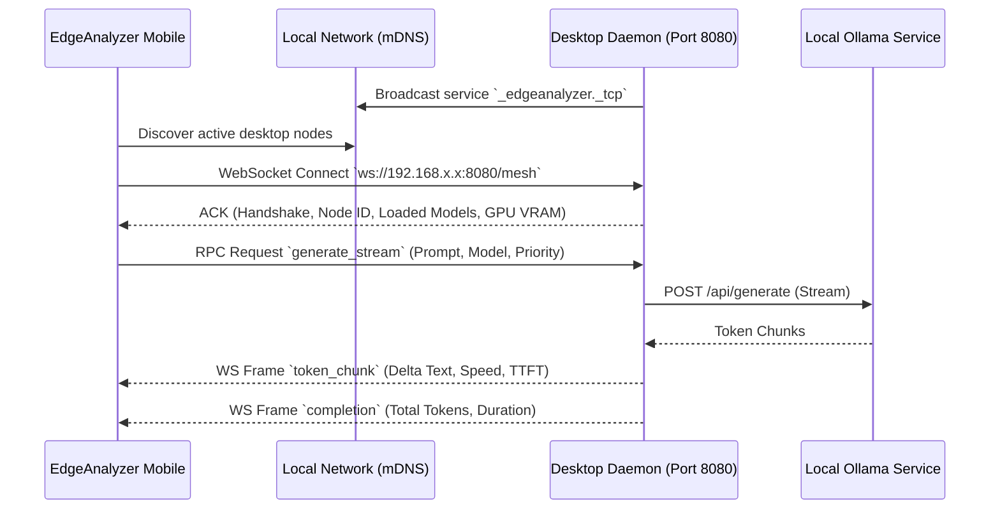
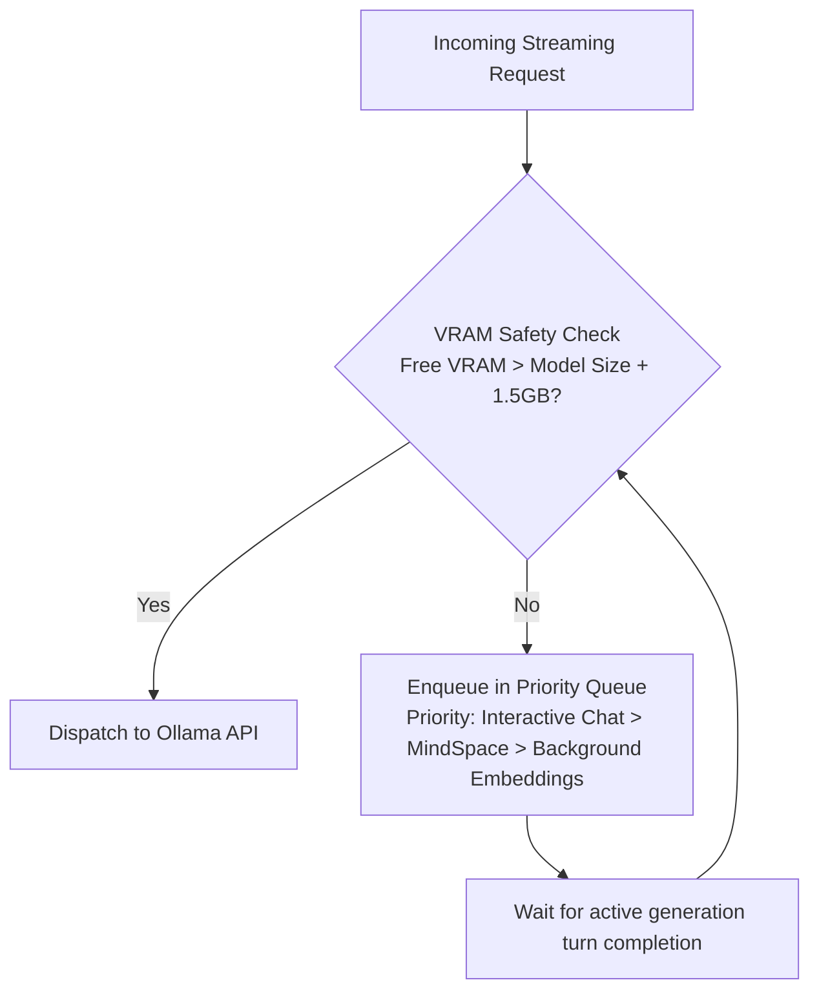
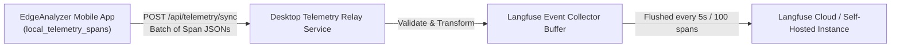

# EdgeAnalyzer Desktop Daemon & Admin UI Specification 🖥️⚡

The **EdgeAnalyzer Desktop Daemon** is a lightweight, high-performance background service and web control panel. It exposes a local GPU inference node to EdgeAnalyzer mobile clients on the local network, manages inference request queues, monitors system VRAM, and acts as a telemetry collection relay to self-hosted or cloud Langfuse instances.

---

## 1. System Overview & Technology Stack

| Layer | Technology | Functional Description |
| --- | --- | --- |
| **Daemon Core** | Node.js / TypeScript (or Rust execution binary) | Asynchronous network server, mDNS beacon, and service coordinator |
| **Local Inference Server** | Ollama API (CUDA / Metal / ROCm) | Local GGUF LLM/VLM execution host |
| **Real-Time Transport** | `ws` (WebSocket) / HTTP REST | Bi-directional streaming RPC framework for mobile mesh communication |
| **Hardware Telemetry** | `systeminformation` / `nvidia-smi` | Real-time monitoring of GPU VRAM, compute utilization, and system thermals |
| **Telemetry Relay** | Langfuse Node SDK / REST Protocol | Batched ingestion of mobile telemetry spans and forwarding to Langfuse |
| **Admin Dashboard** | React / Tailwind CSS (Vite frontend) | Live desktop management interface |

---

## 2. Desktop System Architecture

```text
edge-analyzer-desktop/
├── src/
│   ├── daemon/
│   │   ├── Server.ts                       # Main HTTP & WebSocket server entrypoint
│   │   ├── mdns/
│   │   │   └── DiscoveryService.ts         # LAN mDNS discovery beacon (broadcasting _edgeanalyzer._tcp)
│   │   ├── queue/
│   │   │   └── PriorityInferenceQueue.ts   # Concurrency scheduler & VRAM-aware queue manager
│   │   ├── services/
│   │   │   ├── OllamaBridgeService.ts      # Streaming wrapper for Ollama generation & embeddings
│   │   │   ├── SystemMonitorService.ts     # GPU VRAM & CPU utilization polling service
│   │   │   └── TelemetryRelayService.ts    # Ingestion endpoint & Langfuse sync flusher
│   │   └── websocket/
│   │       └── ConnectionHandler.ts        # WebSocket RPC router for streaming tokens & telemetry
│   └── web-admin/                          # Desktop Web Control Panel (React SPA)
│       ├── src/
│       │   ├── components/
│       │   │   ├── ActiveClientsCard.tsx   # Connected mobile devices list
│       │   │   ├── GpuStatsGauge.tsx       # Live VRAM usage & GPU load speedometer
│       │   │   ├── InferenceQueueTable.tsx # Live request queue status
│       │   │   └── TelemetryStream.tsx     # Real-time span waterfall feed
│       │   └── App.tsx                     # Main Dashboard UI layout
```

---

## 3. Core Execution Pipelines

### A. Mesh Connection & Peer Discovery

The Desktop Daemon advertises its endpoint over local Wi-Fi using mDNS (`_edgeanalyzer._tcp.local.`). When the EdgeAnalyzer Android app launches, it scans the LAN and establishes a persistent WebSocket connection.



---

### B. Fair-Share Priority Queueing & VRAM Guard

To prevent out-of-memory (OOM) faults when processing requests from multiple mobile devices or concurrent background processes, the daemon processes requests through a priority queue:



---

### C. Telemetry Ingestion & Langfuse Relay Pipeline

The Desktop Daemon acts as a centralized telemetry proxy for mobile nodes. Mobile devices accumulate trace spans in their local SQLite outboxes while offline and push them to the Desktop Daemon when reconnected.



#### Transformed Telemetry Span Contract:
```json
{
  "traceId": "trace_1710000000_abc123",
  "id": "span_987654321",
  "name": "desktop.ollama_inference",
  "startTime": "2026-11-23T16:00:00.000Z",
  "endTime": "2026-11-23T16:00:02.150Z",
  "attributes": {
    "target.compute_node": "Desktop-RTX4090",
    "gen_ai.request.model": "llama3.2:3b",
    "gen_ai.completion.ttft_ms": 142,
    "gen_ai.completion.tok_per_sec": 48.5,
    "hardware.vram_used_mb": 4096,
    "client.id": "android_pixel8_001"
  }
}
```

---

## 4. Web Admin Dashboard Features

The Desktop Daemon serves an interactive web dashboard accessible at `http://localhost:8080/admin` or via the desktop LAN IP.

### Dashboard Modules:
1. **System Health & GPU Telemetry**:
   * Real-time GPU load percentage, dedicated VRAM consumption gauge, and thermal reading.
   * Host CPU utilization and active RAM usage indicators.
2. **Mesh Node Directory**:
   * List of connected Android devices with client IDs, IP addresses, latency, and connection timestamps.
3. **Inference Queue Manager**:
   * Monitor active model generations and queued tasks.
   * Manual priority override and task cancellation controls.
4. **Live Telemetry Stream**:
   * Real-time waterfall stream displaying incoming mobile trace spans.
   * Inspection view for total TTFT, tokens/sec, and Langfuse upload status.

---

## 5. REST & WebSocket API Protocol

### A. Health Check & System Status
`GET /api/v1/health`

**Response:**
```json
{
  "status": "online",
  "node_id": "desktop_gpu_node_01",
  "gpu": {
    "name": "NVIDIA GeForce RTX 4090",
    "vram_total_mb": 24576,
    "vram_used_mb": 6144,
    "utilization_pct": 32
  },
  "active_clients": 2,
  "queue_depth": 0,
  "loaded_model": "llama3.2:3b"
}
```

### B. Telemetry Batch Sync
`POST /api/v1/telemetry/sync`

**Payload:**
```json
{
  "client_id": "android_device_df89a",
  "spans": [
    {
      "span_id": "span_001",
      "trace_id": "trace_100",
      "session_id": "conv_2026_11",
      "name": "client.turn_orchestration",
      "observation_type": "span",
      "target_device": "local_android_gpu",
      "start_time": 1770000000000,
      "end_time": 1770000002000,
      "duration_ms": 2000,
      "attributes_json": "{\"user.query_preview\":\"Summarize note\"}"
    }
  ]
}
```

**Response:**
```json
{
  "status": "success",
  "synced_span_ids": ["span_001"],
  "rejected_span_ids": []
}
```

---

## 6. Security & LAN Access Guarantees

1. **LAN-Bound Scope**: By default, the daemon binds to local interfaces (`127.0.0.1` and local `192.168.x.x` subnet IPs), rejecting WAN access.
2. **Auth Token Pairings**: Optional pairing code generated on the Desktop Web Admin required upon initial mobile connection.
3. **Local Telemetry Forwarding**: Telemetry spans relayed to Langfuse omit sensitive prompt strings unless explicit verbosity logging is enabled in the Desktop Admin settings.